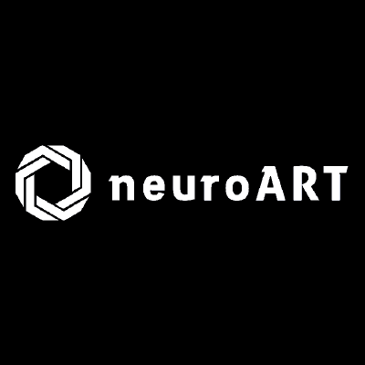
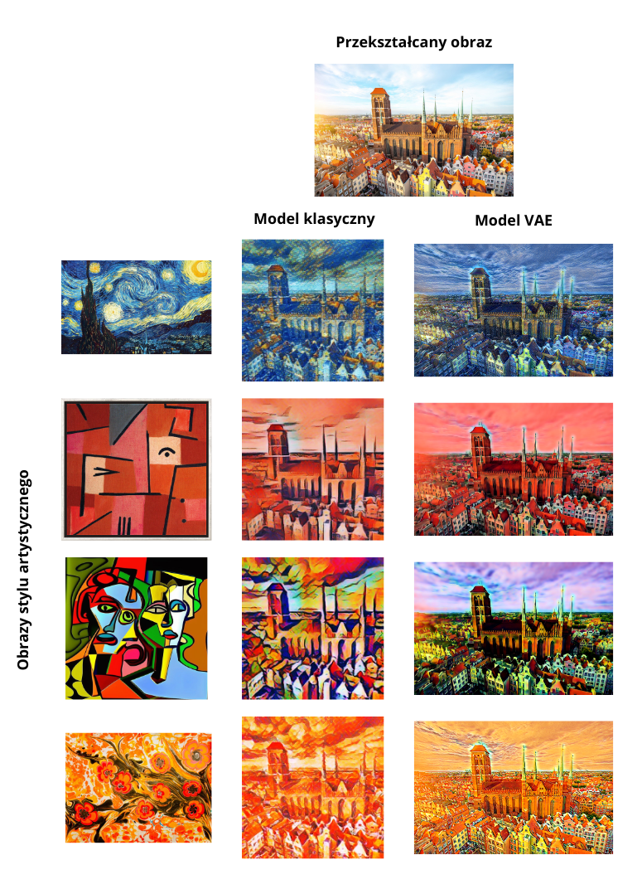
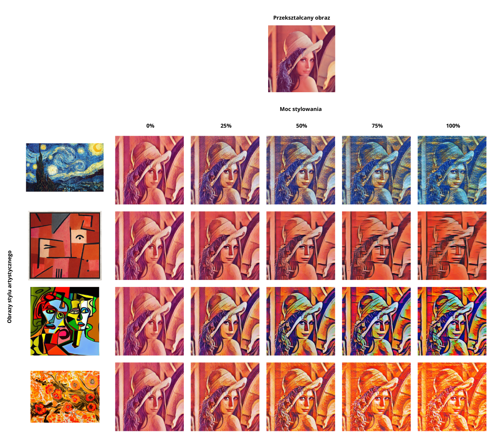
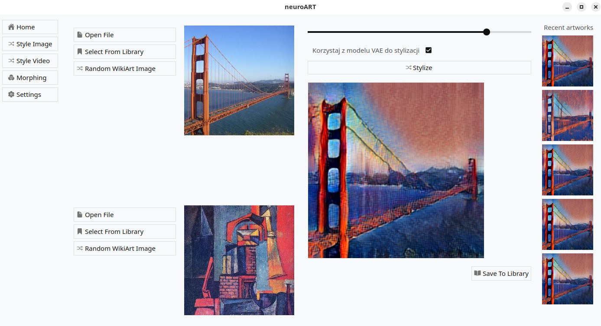
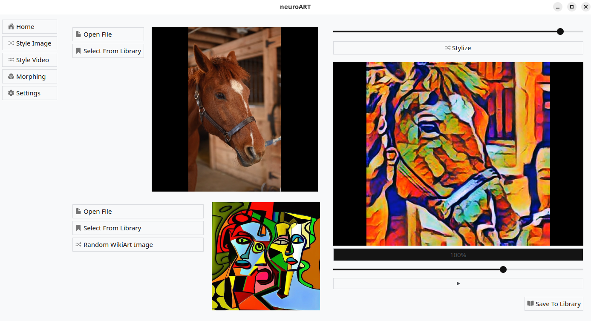

<h1 align="center">
    </br>
    
    </br>
</h1>

<h3 align="center">
    Computational Creativity with Neural Networks on images and videos
    </br></br>
</h3>

- [📖 Overview](#-overview)
    - [Model architecture](#model-architecture)
  - [🛠️ Tech stack](#️-tech-stack)
  - [🚀 Features](#-features)
  - [� Results \& Experiments](#-results--experiments)
  - [🖼️ Screenshots \& Examples](#️-screenshots--examples)
    - [1. Style Transfer comparison](#1-style-transfer-comparison)
    - [2. Style Transfer strength comparison](#2-style-transfer-strength-comparison)
    - [3. Application screenshot - image style transfer](#3-application-screenshot---image-style-transfer)
    - [4. Application screenshot - video style transfer](#4-application-screenshot---video-style-transfer)
  - [⚙️ Installation](#️-installation)
  - [📂 Project Structure](#-project-structure)
  - [🔮 Future Work](#-future-work)
  - [👨‍🎓 Authors](#-authors)
  - [📄 License](#-license)

# 📖 Overview

**Neuro-Art** is a research and experimental application developed as part of the engineering thesis *"Computational Creativity with Neural Networks"*.  
The project explores how **artificial neural networks** can be applied in **computational creativity**, with particular focus on:  

- **Artistic style transfer** (for both images and video),  
- **Image morphing** (smooth transitions between two images),  
- Experiments with **Variational Autoencoders (VAE)** compared to classical style transfer models.  

The application provides a graphical user interface for testing generative AI models and serves as a creative tool for designers and digital artists.  

### Model architecture


## 🛠️ Tech stack
- **Machine Learning:** [PyTorch Lightning](https://lightning.ai/docs/pytorch/stable/), Tensorflow
- **GUI:** [PyQt6](https://pypi.org/project/PyQt6/)  
- **Image Processing:** OpenCV, Pillow, NumPy  
- **Hardware Acceleration:** CUDA (NVIDIA GPU support)  

## 🚀 Features
- **Image Style Transfer** – transform a photo into the style of a famous artwork.  
- **Video Style Transfer** – apply artistic styles to entire video sequences.  
- **Morphing** – generate smooth transitions between two input images.  
- **VAE-based Transfer** – alternative style transfer using latent space interpolation.  

## 📊 Results & Experiments
- Comparison of **classical vs. VAE-based** style transfer,  
- Evaluation of **morphing algorithms** (traditional vs. neural),  
- Video style transfer **performance improvements** using interpolation,  
- Many **visual examples** of generated artistic outputs.  


## 🖼️ Screenshots & Examples  

### 1. Style Transfer comparison
  

### 2. Style Transfer strength comparison  
  

### 3. Application screenshot - image style transfer
  

### 4. Application screenshot - video style transfer
  

*(All examples were generated using the implemented system.)*  


## ⚙️ Installation
1. Clone the repository:  
   ```bash
   git clone https://github.com/neuroviscode/neuro-art.git
   cd neuro-art
   ```

2. Create a virtual environment and install dependencies:  
   ```bash
   python -m venv venv
   source venv/bin/activate   # Linux/MacOS
   venv\Scripts\activate      # Windows

   pip install -r requirements.txt
   ```

3. Install CUDA for GPU acceleration.  

4. Run the application:  
   ```bash
   python main.py
   ```

## 📂 Project Structure
```
neuro-art/
│── logic/              # Core logic and ML models
│   ├── morphing/       # Morphing algorithms
│   ├── preprocessing/  # Image loading & preprocessing
│   ├── style_transfer/ # Classical style transfer
│   ├── style_transfer_vae/ # VAE-based style transfer
│   └── vae_models/     # VAE architectures
│
│── widgets/            # GUI (PyQt6)
│   ├── home/           # Home screen
│   ├── library/        # User's saved works
│   ├── morphing/       # Morphing interface
│   ├── style_image/    # Image style transfer
│   ├── style_video/    # Video style transfer
│   └── settings/       # Application settings
│
│── assets/             # Resources
│   ├── examples/       # Example input images
│   ├── icons/          # UI icons
│   ├── models/         # Pretrained models
│   └── results/        # Generated outputs
```

## 🔮 Future Work
- Integration with **diffusion models** (Stable Diffusion, DALL·E, MidJourney-like approaches),  
- Latent-space morphing for smoother artistic transitions,  
- Web-based version with API support,  
- Cloud deployment for GPU rendering.  

## 👨‍🎓 Authors
Developed as part of the **Engineering Thesis**  
Computer Science – Intelligent Interactive Systems  
Gdańsk University of Technology

- inż. Paweł Cichowski  
- inż. Michał Cellmer  
- inż. Jakub Link  

Supervisor: **dr hab. inż. Julian Szymański**  


## 📄 License
This project is released under the **MIT License**.  
See [LICENSE](LICENSE) for details.  
